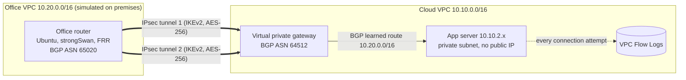

# AWS Hybrid Network Lab


A hybrid cloud network built entirely as code: a simulated on-premises
office connected to an AWS VPC over a redundant, encrypted site-to-site
VPN, with routes exchanged over BGP, automated router provisioning in
Python, an end-to-end health check, and a port scan detector built on VPC
Flow Logs.

This is the setup companies use to connect their own data centers or
offices to AWS, and the work a network development engineer automates:
building the network, keeping the routing correct, and proving it works.

## Architecture



| Network | CIDR | Purpose |
|---|---|---|
| Cloud VPC | 10.10.0.0/16 | The company's AWS environment |
| Cloud private subnet | 10.10.2.0/24 | App server, no internet route |
| Office VPC | 10.20.0.0/16 | Simulated on premises network |
| Office public subnet | 10.20.1.0/24 | Office router with an Elastic IP |

## What it demonstrates

**Networking**
* Site-to-site IPsec VPN with two tunnels to separate AWS endpoints
* eBGP between the office router (FRR) and AWS, with BGP learned routes
  propagated automatically into the cloud route table
* Route-based VPN using one XFRM interface per tunnel
* Non-overlapping address plan and longest prefix match routing

**Automation**
* All infrastructure in Terraform; the whole lab is created and destroyed
  with one command each
* `configure_router.py` reads the tunnel details from the AWS API and
  configures strongSwan and FRR on the router through SSM Run Command
* `health_check.py` validates the network from AWS's view, the route
  table, the router's BGP state, and real traffic
* 31 unit tests and Terraform validation run in GitHub Actions on every push

**Security**
* Only strong VPN algorithms allowed (IKEv2, AES-256, SHA-256, DH group 20)
* Router firewall accepts IPsec only from AWS's two tunnel endpoints
* App server reachable only from the office range, with egress only to
  the office, and no public IP or internet route
* No SSH anywhere: admin access through Session Manager, logged per user
* IMDSv2 required and encrypted volumes on every instance
* Pre-shared keys fetched at runtime and never stored in the repository
* AWS CLI uses short-term `aws login` credentials with MFA, not access keys
* VPC Flow Logs plus a port scan detector

## Results

Health check against the running lab:

```
CHECK                         STATUS  DETAIL
VPN tunnels (AWS view)        PASS    2/2 tunnels UP
Cloud route to office         PASS    10.20.0.0/16 via vgw-... (learned over BGP)
BGP sessions (router view)    PASS    2/2 established (169.254.104.185: 1 received, 169.254.155.97: 1 received)
Ping office -> app 10.10.2.215  PASS  0% loss, avg 1.461 ms
HTTP office -> app 10.10.2.215  PASS  page served by the app server

5 passed, 0 warnings, 0 failed
```

A simulated port scan from a compromised office host
(`nc -z -w 1 -s 10.20.1.46 10.10.2.215 20-50`), caught in the flow logs:

```
Read 37 flow records (6 accepted, 31 rejected)

ALERT: vertical port scan from 10.20.1.46 against 10.10.2.215
  32 distinct ports, 31 rejected by the firewall
```

The detector ignores replies to ephemeral ports, so normal traffic to a
busy server does not look like a scan.

## Running it

Requirements: an AWS account, Terraform 1.6 or newer, AWS CLI 2.32 or
newer, and Python 3.13.

```bash
python3 -m venv .venv && source .venv/bin/activate
pip install -r requirements.txt

aws login                                   # short-term credentials
terraform -chdir=terraform init
terraform -chdir=terraform apply            # about 10 minutes, mostly the VPN

python automation/configure_router.py --dry-run   # review, keys hidden
python automation/configure_router.py             # configure IPsec and BGP
python automation/health_check.py                 # verify end to end
python automation/detect_port_scan.py             # check flow logs for scans

terraform -chdir=terraform destroy          # always, at the end of a session
```

**Cost:** about 8 cents per hour while running, mostly the VPN
connection. Nothing is left running after `destroy`.

## Repository layout

```
terraform/      VPCs, router, VPN, app server, flow logs
automation/     configure_router.py, health_check.py, detect_port_scan.py
tests/          unit tests for all three scripts
docs/           one write up per phase, with the verification results
```

## Problems solved along the way

* **First CLI login issued root credentials** because the browser reused an
  open root console session. Caught with `aws sts get-caller-identity`
  and logged in again as the IAM admin user.
* **Dependency cycle in Terraform:** the router's firewall needed the VPN's
  tunnel IPs, the VPN needed the router's Elastic IP, and the Elastic IP
  was attached to the router. Fixed by creating the Elastic IP on its own
  and attaching it with a separate association.
* **Router script failed on its first real run:** SSM runs commands with
  `/bin/sh` (dash), which has no `pipefail`. Switched to `set -eu`.
* **FRR exchanged no routes at first by design:** FRR requires a policy on
  eBGP sessions before it will send or accept routes.

## Known limitations

* The router advertises the route it learned on one tunnel back out the
  other. AWS discards it through AS path loop prevention; an outbound
  prefix filter is the proper fix.
* SSM Run Command keeps command parameters, including the pre-shared keys,
  in its history. A production design would have the router read them
  from Secrets Manager.
* Single availability zone, to keep the lab small. Production would span
  at least two.

## Next steps

* Tunnel failover test: take down the active tunnel and measure how long
  BGP takes to move traffic to the backup
* BGP route leak and hijack demo, then prefix filtering to stop it
* Real time alerts from the detector through EventBridge and SNS

Each phase is documented in [`docs/`](docs/).
